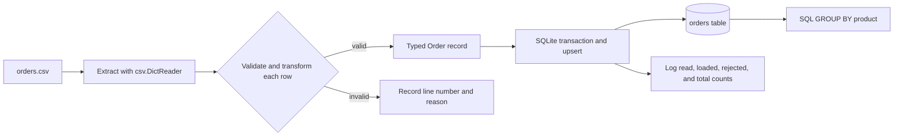
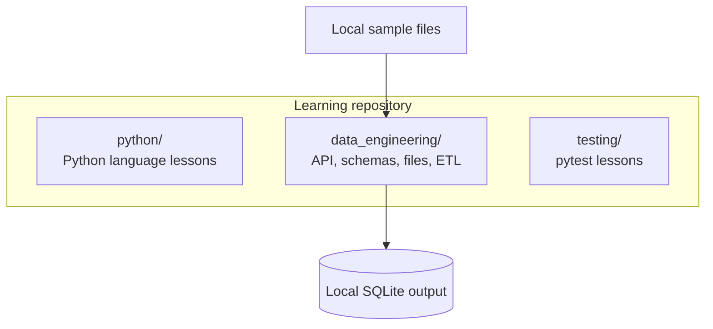

# Python and Data Engineering Learning Lab

A hands-on learning repository for Python fundamentals and introductory data engineering. It contains small scripts, pytest examples, sample data, and Jupyter notebooks. The examples are deliberately self-contained so you can run a lesson, inspect the output, and then change it.

This is a teaching repository rather than a production framework. The batch pipeline demonstrates useful foundations—validation, transactions, idempotent loading, and SQL aggregation—but it does not replace a production orchestration or warehouse platform.

## What you will learn

- Core Python collections, functions, generators, exceptions, files, and logging.
- Classes, encapsulation, inheritance, decorators, and polymorphism.
- When to use threads versus asynchronous tasks for I/O work.
- How Python can inspect files and build paths safely.
- How to call HTTP endpoints and inspect JSON responses.
- How to validate structured data with Pydantic and pandas.
- How a small batch ETL flow reads, validates, transforms, and loads records.
- How pytest checks behavior, exceptions, parameterized cases, classes, and mocked requests.

The lessons assume basic familiarity with a terminal and Python syntax. The project requires Python 3.12 or newer.

## Quick start

Install [uv](https://docs.astral.sh/uv/getting-started/installation/) if it is not already installed. From the repository root, synchronize the project environment and run a first example:

```shell
uv sync
uv run python python/fundamentals/core_types.py
```

Run the automated tests with:

```shell
uv run pytest -q
```

The project dependencies and their locked versions are described in `pyproject.toml` and `uv.lock`. The source examples use Python's standard library unless a lesson specifically uses pandas, Pydantic, pytest, or requests.

### Optional notebook and Parquet support

The notebooks need Jupyter, and the Parquet lessons need a pandas Parquet engine. Install those optional tools into the project environment after `uv sync`:

```shell
uv pip install jupyterlab ipykernel pyarrow
uv run jupyter lab
```

Then open `data_engineering/apis/http_requests.ipynb` or a notebook under `data_engineering/pydantic/`. Jupyter and PyArrow are optional and are not pinned in the project's lockfile; a later `uv sync` may remove packages installed only this way.

## Repository map

```text
.
├── python/
│   ├── fundamentals/          # Collections, functions, generators, errors, files
│   ├── oop/                   # Classes, constructors, class/instance attributes
│   ├── inheritance/           # Single, multiple, and multilevel inheritance
│   ├── polymorphism/          # Polymorphism and decorators
│   ├── concurrency/
│   │   ├── asyncio/           # Coroutines and concurrent tasks
│   │   └── threading/         # ThreadPoolExecutor example
│   └── os/                    # Paths and filesystem inspection
├── data_engineering/
│   ├── apis/                  # HTTP and REST examples in a notebook
│   ├── pydantic/              # Data models, validation, serialization
│   ├── pandas/                # CSV, JSON, TSV, and Parquet examples + sample data
│   ├── validation.py          # Typed order model and row-level validation
│   └── batch_pipeline.py      # CSV-to-SQLite ETL example
├── testing/
│   ├── basics/
│   ├── parameterized/
│   ├── classes/
│   ├── check_errors/
│   └── mocks/
├── pyproject.toml             # Python version and dependencies
└── uv.lock                    # Reproducible dependency versions
```

## A suggested learning path

1. Start with `python/fundamentals/` for collections, function arguments, generators, exceptions, and context managers.
2. Read `python/oop/`, then compare the inheritance examples and the decorator examples.
3. Compare `python/concurrency/asyncio/` with `python/concurrency/threading/` to see two ways to overlap waiting work.
4. Explore the HTTP and Pydantic notebooks, then inspect the pandas readers and sample files.
5. Follow the batch pipeline from its input CSV through validation into SQLite.
6. Read the lessons under `testing/`, and run the suite with `uv run pytest -q`.

## Running the examples

Run commands from the repository root. `uv run` uses the environment created by `uv sync` and makes the project's dependencies available.

### Python fundamentals and OOP

```shell
uv run python python/fundamentals/core_types.py
uv run python python/fundamentals/functions_and_generators.py
uv run python python/fundamentals/errors_and_files.py
uv run python python/oop/basics.py
uv run python python/oop/constructors.py
uv run python python/oop/class_methods.py
uv run python python/oop/encapsulation.py
uv run python python/inheritance/single_level.py
uv run python python/inheritance/multi_level.py
uv run python python/inheritance/multiple_1.py
uv run python python/inheritance/multiple_2.py
uv run python python/polymorphism/polymorphism.py
uv run python python/polymorphism/decorator.py
uv run python python/os/basics.py
```

The examples are guarded by `if __name__ == "__main__":` so importing a lesson does not normally run its demonstration. The sample file used by `errors_and_files.py` is resolved relative to the script.

### Asyncio and threads

```shell
uv run python python/concurrency/asyncio/basics.py
uv run python python/concurrency/asyncio/await_api.py
uv run python python/concurrency/asyncio/multiple_apis.py
uv run python python/concurrency/asyncio/multiple_tasks.py
uv run python python/concurrency/threading/multi_threading.py
```

These examples simulate waiting with sleeps; they do not contact real APIs. The asyncio examples use `await` and `asyncio.gather()` to let tasks make progress while waiting. The threading example uses `ThreadPoolExecutor` for independent blocking tasks. Asyncio is useful for many cooperative I/O tasks; threads are often a simpler fit when calling synchronous blocking libraries. Neither example is intended to demonstrate CPU-parallel Python computation.

### Data extraction and format examples

```shell
uv run python data_engineering/pandas/data_extraction.py
uv run python data_engineering/pandas/dataframe_decorator.py
```

The extraction lesson reads sample CSV, JSON, TSV, and Parquet files from `data_engineering/pandas/sample_data/`. The decorator example reads a CSV from `data_engineering/pandas/decorator_data/` and writes a Parquet result under `data_engineering/pandas/output/`.

Parquet support requires PyArrow or another compatible pandas engine. The optional setup above installs PyArrow. Generated files under `data_engineering/pandas/output/` are ignored by Git.

### Batch ETL: CSV to SQLite

Run the pipeline with the included orders file:

```shell
uv run python -m data_engineering.batch_pipeline
```

By default, the source is `data_engineering/pandas/sample_data/orders.csv` and the SQLite database is `data_engineering/orders.sqlite3`. The default paths are based on the script location, so the command can be run from the repository root without editing the script. To use another source or database path:

```shell
uv run python -m data_engineering.batch_pipeline --input path/to/orders.csv --database path/to/orders.sqlite3
```

Use `uv run python -m data_engineering.batch_pipeline --help` to see the command options. The default database is generated output and is ignored by Git.

The pipeline reports rows read, loaded, rejected, and the total number of orders in SQLite. The sample input has five valid rows, so a first run reports five loaded rows and zero rejected rows. A repeated run updates existing records by `OrderID` rather than inserting duplicates.

## Concepts and theory

### Python foundations

Python's built-in containers solve different data-shaping problems: lists preserve order and can change; tuples preserve order but are immutable; sets hold unique values; dictionaries map keys to values. Comprehensions and `Counter` show concise ways to transform and summarize collections.

Functions package behavior behind inputs and outputs. Keyword-only arguments make options explicit. A generator yields one value at a time, which is useful when processing a large stream without storing every intermediate value. The file-processing lesson uses a context manager (`with`) so a file closes reliably, and it raises a clearer exception while preserving the original I/O error as its cause.

### Object-oriented programming

A class defines behavior and data shared by instances. Instance attributes belong to one object; class attributes are shared through the class unless an instance shadows them. Inheritance lets a child reuse or override parent behavior. With multiple inheritance, Python uses a method-resolution order to decide which implementation wins; these examples explicitly call a chosen parent method. Polymorphism lets different objects expose a common method name. A decorator wraps a function to add behavior around its call.

In Python, a leading underscore signals a non-public convention; it is not access control. Double underscores trigger name mangling, which helps avoid accidental name collisions but does not make an attribute truly private.

### Concurrency

Concurrency overlaps progress; it does not necessarily mean that Python instructions execute simultaneously on multiple CPU cores. `asyncio` uses cooperative scheduling: a coroutine yields control at `await`, allowing other tasks to proceed. A thread pool runs synchronous functions on worker threads and is useful for blocking I/O. The repository's examples model waiting, rather than implementing real HTTP concurrency or CPU-heavy work.

### HTTP, schemas, and tabular files

The API notebook demonstrates HTTP GET and POST requests, query parameters, headers, response status codes, JSON, and authentication shapes. Some cells contact the public JSONPlaceholder example service. Other cells contain placeholder endpoints and credentials; those are patterns to replace, not working secrets.

The Pydantic notebooks show how declared model fields become a validation boundary: types can be coerced or made strict, and field constraints can enforce ranges, lengths, optional fields, and allowed values. Serialization converts validated models to dictionaries or JSON. The pandas examples show reading common tabular interchange formats into DataFrames.

### Batch ETL pipeline

Data engineering builds the systems that collect, validate, transform, and store data so other software and people can use it. A batch job processes a bounded group of records, often on demand or on a schedule; a streaming system handles an ongoing sequence of events. This repository demonstrates batch processing only.

ETL means Extract, Transform, Load. Extract reads source records; Transform cleans, validates, and converts them into a defined shape; Load writes the accepted records to a target. In ELT, raw data is loaded first and transformed in the target. This repository uses ETL with a CSV source and a local SQLite database, which keeps the full flow inspectable without cloud accounts or extra infrastructure.



`data_engineering/validation.py` checks required values, converts IDs and quantities to integers, parses ISO dates, trims names, and represents money as integer cents. The immutable `Order` dataclass gives validated rows a consistent in-memory shape. Integer cents avoid binary floating-point rounding surprises for currency. Invalid records are rejected individually with a reason; valid records continue through the batch.

`data_engineering/batch_pipeline.py` creates a SQLite table with constraints, then writes accepted rows inside a transaction. `OrderID` is the primary key. The `INSERT ... ON CONFLICT ... DO UPDATE` statement makes rerunning the same input idempotent: it updates the row with that key instead of adding a duplicate. After loading, a SQL `GROUP BY` query calculates revenue per product. Logging makes the batch counts and rejected-row reasons visible.



The current pytest suite exercises the Python testing lessons. It does not yet contain dedicated tests for the batch pipeline, and SQLite is being used as a teaching target rather than a distributed warehouse.

